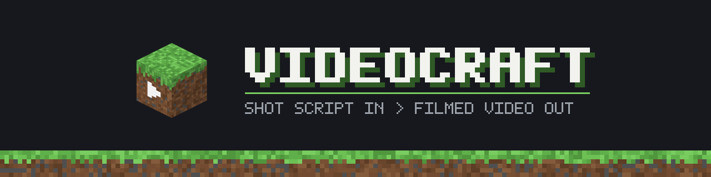

<p align="center"></p>

# videocraft

videocraft films videos inside Minecraft Java 26.3 from a shot script: a TOML file of shots, cameras, actors, lines
and edit decisions. One command plays the script in a hidden, muted game, captures every frame from the game's own
framebuffer, cuts and mixes the video, measures it, and can have reviewer agents score it so an agent can improve
the script and try again.

It is a tool for people and coding agents who want repeatable, scriptable Minecraft video. It is early, verified on
one platform, and not affiliated with Mojang ([below](#credits-and-trademarks)).

## Trailer

[](https://github.com/alexandros-lekkas/videocraft/releases/download/trailer-1/videocraft-trailer-720p30.mp4)

**The trailer** ([720p, 13 MB](https://github.com/alexandros-lekkas/videocraft/releases/download/trailer-1/videocraft-trailer-720p30.mp4) · [1080p60](https://github.com/alexandros-lekkas/videocraft/releases/download/trailer-1/videocraft-trailer-1080p60.mp4) · [9:16](https://github.com/alexandros-lekkas/videocraft/releases/download/trailer-1/videocraft-trailer-9x16.mp4)):
84 seconds, made with videocraft itself from real runs ([trailer/](trailer/)). A prompt goes to an agent, which
builds the set and films the take inside Minecraft, edits on the spoken word and has reviewers score the cut.

## Demo

[](https://github.com/alexandros-lekkas/videocraft/releases/download/demo-nibs-vs-duke-2/nibs-vs-duke-720p30.mp4)

**Nibs vs Duke** ([720p, 8 MB](https://github.com/alexandros-lekkas/videocraft/releases/download/demo-nibs-vs-duke-2/nibs-vs-duke-720p30.mp4) · [1080p60, 23 MB](https://github.com/alexandros-lekkas/videocraft/releases/download/demo-nibs-vs-duke-2/nibs-vs-duke-1080p60.mp4)):
a one-horned goat challenges a three-time Talent Night champion fox. 30 shots in 75 s, every frame staged and
filmed in a hidden Minecraft client from one script ([examples/nibs-vs-duke.toml](examples/nibs-vs-duke.toml)):
built sets, scripted mob actors, lead-track cameras, a framed flashback, a sub-second montage, word-timed captions,
local open-source voices, and an original synthesized music bed (this export contains no Mojang audio). It is the
benchmark of [docs/benchmarks/pinksheep-style.md](docs/benchmarks/pinksheep-style.md); reviewers score it **6.6/10**
against that rubric (pass is 7), and [the production log](docs/benchmarks/nibs-vs-duke-log.md) says why.

Example outputs, as they are published, are listed in [docs/GALLERY.md](docs/GALLERY.md).

## What it can do

| | One line of a script, or one command |
|:--|:--|
| **Cameras** that move like an operator: `lead`, `chase`, `track`, `dolly`, `crane`, `locked`, `two_shot`, `face`, `orbit`, `fixed`, `first` | `camera = { rig = "lead", subject = "nibs", distance = 4, fov = 105 }` |
| **Actors**: any mob or a player-shaped mannequin, moved only by the script (walks, turns, looks, poses, the animal's own sit, sleep, bow) | `kind = "mob", entity = "goat", left_horn = false, tint = "#7f8fa6"` |
| **Dialogue**: local text-to-speech per character, captions that pop on each spoken word, cuts that land on a word | `do = "say", actor = "nibs", text = "I challenge *Duke!", cut_on = "Duke"` |
| **Text drawn in the game**: captions, titles, cards, lower thirds, keycaps, measured against phone-readable layout rules | `do = "caption", text = "Build *anything."` |
| **Sound**: every sound the game plays is logged on its frame and rebuilt in the mix; note-block tunes; an original synth music bed | `music = { source = "synth", style = "sneaky", bpm = 112 }` |
| **A frame-exact edit**: trims on marks, push-ins with pixel-exact holds, speed ramps, dips to black, framed and graded flashbacks, exports | `push = [{ at = "landed", zoom = 1.5, hold = 40 }]` |
| **Sets**: places to film written as data (`market-lane`, `barn-stage`, `black-stage`, `keynote-stage`, `office`), with named marks | `[[world.set]]` `name = "market-lane"`, then `{ anchor = "market-lane:stall-red" }` |
| **Stories**: a one-line premise drafted by a model into a bible, an outline, a script and a shot script | `bin/videocraft make "a goat challenges a fox to a jump-off"` |
| **Long form and shorts**: runs joined with chapter cards; 9:16 shorts re-shot vertical or re-framed | `bin/videocraft clips cut <run> --from 12 --to 40 --method reshoot` |
| **Judging**: measurements (shot lengths, camera jerk, text rules, loudness), review packets of stills, reviewer agents, a hill-climb | `bin/videocraft climb examples/hello.toml --budget 3` |

The same script and seed give the same take: the game runs on a fixed frame clock and actors are driven from it,
so two takes of `examples/rigs.toml` match frame for frame.

## Install

**Verified on macOS on Apple silicon** (M4 Pro, macOS 26, the OpenGL backend). **Linux and Windows are untested**:
Linux will need a virtual display ([docs/issues/01-linux-xvfb.md](docs/issues/01-linux-xvfb.md)) and Windows paths
have not been tried ([02](docs/issues/02-windows-paths.md)).

You need:

- **JDK 25.** Homebrew: `brew install openjdk@25`. It is keg-only; `bin/videocraft` finds it by itself. For raw
  Gradle, `export JAVA_HOME=/opt/homebrew/opt/openjdk@25/libexec/openjdk.jdk/Contents/Home` (a newer JDK as
  `JAVA_HOME` fails the build).
- **ffmpeg** with libx264 and ffprobe: `brew install ffmpeg`.
- **Python 3.11 or newer** (standard library only; nothing to `pip install`).
- About 1 GB of disk for Gradle, Loom and the development copy of Minecraft, downloaded on the first run. You do not
  install the game yourself; Fabric's Loom fetches it from Mojang's servers, as for any Fabric mod's development.

Optional:

- **Voice** for dialogue: `bin/videocraft voice setup` makes `cache/voice/venv` (about 1.3 GB) and downloads the
  model weights (about 3.8 GB) into your Hugging Face cache. The default voice (Qwen3-TTS on MLX) runs on Apple
  silicon only. Without it, `say` lines still compile and run on estimated reading timings, with captions and no
  voice. [docs/VOICE.md](docs/VOICE.md)
- **Reviewer and story agents**: the `claude` CLI on your `PATH`, or `ANTHROPIC_API_KEY` set for the Anthropic API. Everything else works
  without them. [docs/REVIEW.md](docs/REVIEW.md), [docs/STORY.md](docs/STORY.md)

## Quickstart

From a fresh clone. The first `run` spends about five minutes on one-time setup; after that a short take is under a
minute.

```sh
git clone https://github.com/alexandros-lekkas/videocraft.git && cd videocraft
bin/videocraft doctor                       # JDK, ffmpeg, folders, free slots; ends READY
bin/videocraft run examples/hello.toml      # a 3 s orbit around spawn at 1080p60
```

The first time, `run` prints its first two lines and then nothing for several minutes while Gradle, Loom and the
development copy of Minecraft download and build (follow it in `runs/hello/0001/take/game.log`). Every run ends
like this (exit 0 PASS, 1 FAIL, 2 no verdict):

```text
RESULT   PASS 1920x1080 60 fps 180 frames 3.00 s; capture 79.3 fps real time
VIDEO    <repo>/runs/hello/0001/cut/master.mp4
RUN      <repo>/runs/hello/0001
LOG      <repo>/runs/hello/0001/take/game.log
TIME     27 s
```

Look at a frame (frame 90 of 180):

```sh
mkdir -p /tmp/videocraft && ffmpeg -v error -y -i runs/hello/latest/cut/master.mp4 \
  -vf "select='eq(n\,90)'" -fps_mode passthrough -frames:v 1 /tmp/videocraft/hello-90.png
open /tmp/videocraft/hello-90.png           # macOS; or open the mp4 itself
```

Then a scene with actors, dialogue and captions: a one-horned goat and a snow fox trade four lines, each shot as
long as its line, the second cut on the word "Duke".

```sh
bin/videocraft run examples/talk.toml       # without the voice installed: estimated timings, captions, no voice
bin/videocraft run examples/animals.toml    # mob actors: a strutting goat, a fox that sits, bows and sleeps
```

Measured on 2026-11-12 from a fresh clone with an empty Gradle home, on an M4 Pro sharing the machine with two
other takes:

| Step | Time |
|:--|:--|
| `doctor` | 1 s |
| first `run examples/hello.toml` (downloads Gradle, Loom and Minecraft, 1.1 GB; compiles the mod) | 5 min 28 s |
| `run examples/hello.toml` again | 42 s |
| looking at a frame | 2 s |
| `run examples/talk.toml` (no voice installed: estimated timings) | 59 s |
| `run examples/animals.toml` (28 s of video) | 65 s |

Every example in `examples/` is a working script with a comment at the top saying what it shows: `rigs` (every
camera), `walk` (the played player), `mannequins`, `text`, `edit`, `sound`, `sets`.

## How it works

```
 script.toml ──compile──▶ plan.json ──take (hidden game)──▶ shots/<name>/video.mp4, frames.csv, actors.csv,
   (you or      (CLI)        │                                  sounds.csv, text.json, marks.json
    an agent)                │ say lines → local TTS → word times → captions, shot lengths, voice
                             ▼                                                │
 score.json ◀──review── review/*.json ◀──measure── cut/master.mp4 ◀──cut + mix─┘
     │          (agents,       (stills       (CLI)           (ffmpeg; game sounds from your
     │           optional)      and numbers)                  own assets, synth bed, voice)
     └──── climb: edit the script, run again with --parent, keep it if the score went up ────┘
```

Two parts in one repository:

- **A Fabric mod** (Java 25) that does nothing unless the CLI starts it. In a take it opens a hidden window (no
  focus, no Dock icon, master volume 0), builds the world from a seed or a saved copy, stages it, then for each shot
  waits until the world is drawn and records exactly `duration × fps` frames on a fixed clock: the frame rendered
  last is read from the framebuffer and piped to ffmpeg, then game time advances one frame. Cameras are videocraft's
  own rigs; actors are client-side puppets driven from the same clock; text is drawn on the game's HUD layer.
- **A Python CLI** (standard library only) that compiles the script, runs the take in this checkout's own
  `run-game/` folder (never a real Minecraft folder), and does everything after: the cut, the mix, measuring,
  review packets, scores, the hill-climb, stories, sets, clips. Every stage writes its output to the run store,
  `runs/<name>/<n>/`, so iterations can be compared.

At most three takes run on one machine at once (one per checkout), each on its own loopback control port
(25750–25752). Details: [docs/DESIGN.md](docs/DESIGN.md).

## Docs

| Doc | What is in it |
|:--|:--|
| [AGENTS.md](AGENTS.md) | The five-minute brief for coding agents and contributors: commands, project map, hard rules, hard-won facts |
| [docs/DESIGN.md](docs/DESIGN.md) | Architecture, the mod/CLI boundary, the run store, the extension point, status |
| [docs/SCRIPT.md](docs/SCRIPT.md) | The shot script: every key, action and camera rig |
| [docs/VOICE.md](docs/VOICE.md) | Dialogue: the cast file, engines, word timings, cutting on words |
| [docs/SOUNDS.md](docs/SOUNDS.md) | Sounds by meaning: the Minecraft sound and music map, the comedy palette, the original library |
| [docs/SETS.md](docs/SETS.md) | Sets as data, their marks, the build vocabulary, skins |
| [docs/STORY.md](docs/STORY.md) | Premise to shot script: story, series, make |
| [docs/CLIPS.md](docs/CLIPS.md) | Long form (assemble) and vertical shorts (clips) |
| [docs/REVIEW.md](docs/REVIEW.md) | Packets, reviewers, the rubric, scores and the hill-climb |
| [docs/benchmarks/](docs/benchmarks/) | The benchmark: the form of a reference comedy short, shot for shot, and its rubric |
| [docs/GALLERY.md](docs/GALLERY.md) | Example outputs |
| [CONTRIBUTING.md](CONTRIBUTING.md), [docs/issues/](docs/issues/) | How to help; good first issues |

## Status

videocraft 0.1.0, built in November 2026. What that means in practice:

**Verified** (on macOS, Apple silicon): all eleven scripts in `examples/` end `RESULT PASS` (rechecked on
2026-11-12; `talk.toml` without the voice installed); takes are deterministic
(two takes of `examples/rigs.toml` match frame for frame; two takes with puppets give byte-identical `actors.csv` and `sounds.csv`); capture
runs at 1080p60 faster than real time; push-in holds are pixel-exact (`videocraft edit verify`); the mix's onsets
land on their frames; dialogue is synthesized and aligned locally with Qwen3-TTS and wav2vec2; vertical 1080x1920
takes work; `./gradlew build` and the CLI's unit tests run in CI.

**Not verified or not built yet:**

- Linux and Windows (untested); Sodium (not in the pack until capture is checked with it).
- The integrated server runs in real time, not on the frame clock, so server-side motion (vanilla mobs with AI,
  block updates) is not frame-exact; puppets are, which is why actors are client-side. Pixels can still differ in the
  clouds.
- The played player (`actor = "player"`) runs on the client's own ticks and is not frame-exact between takes.
- Planned and not built: `until` end conditions on shots, a warm client that takes several plans (`POST /take`), and
  the player actions `use`, `break`, `select`, `type`, `open`, `close`, `click` with a drawn pointer.
- `videocraft modpack` writes an `.mrpack`; importing it into the Modrinth app has not been tried.
- Review scores come from model reviewers that see stills and numbers, never motion or sound; their scores wobble by
  about a point between runs ([docs/REVIEW.md](docs/REVIEW.md)).

## Credits and trademarks

**Minecraft is a trademark of Mojang Synergies AB / Microsoft. videocraft is an unofficial tool, not approved by or
associated with Mojang or Microsoft.** No Minecraft textures, sounds, music or fonts are in this repository or in the
mod; music and sounds for an edit are read at export time from your own local game assets. The art in `assets/` is
original and drawn by code.

videocraft grew out of the launch-trailer recorder of [T3 Craft](https://github.com/alexandros-lekkas/t3craft) (MIT,
by Maxwell Young and Alexandros Lekkas): the hidden window, the fixed-step frame clock, framebuffer capture, the
camera operator spring and the human input model were first written there and rewritten here to be generic.
It is built on Fabric, FFmpeg and Gradle; the optional voice uses open-weights models (Qwen3-TTS, Kokoro, wav2vec2)
downloaded on setup. Full credits, licences and the benchmark's terms: [CREDITS.md](CREDITS.md).

## Licence

[MIT](LICENSE). Security reports: [SECURITY.md](SECURITY.md).
